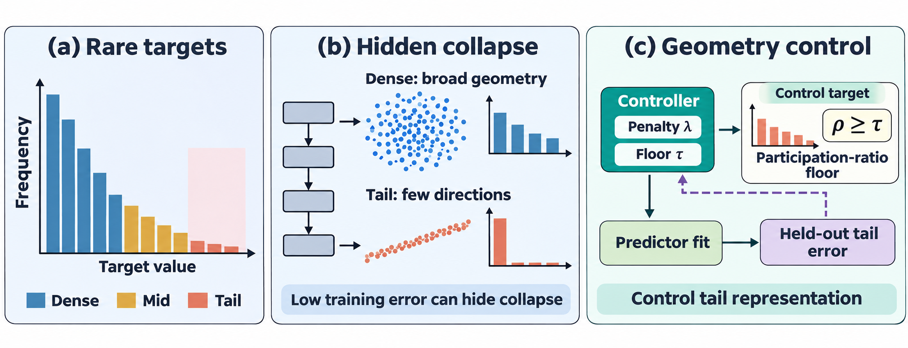
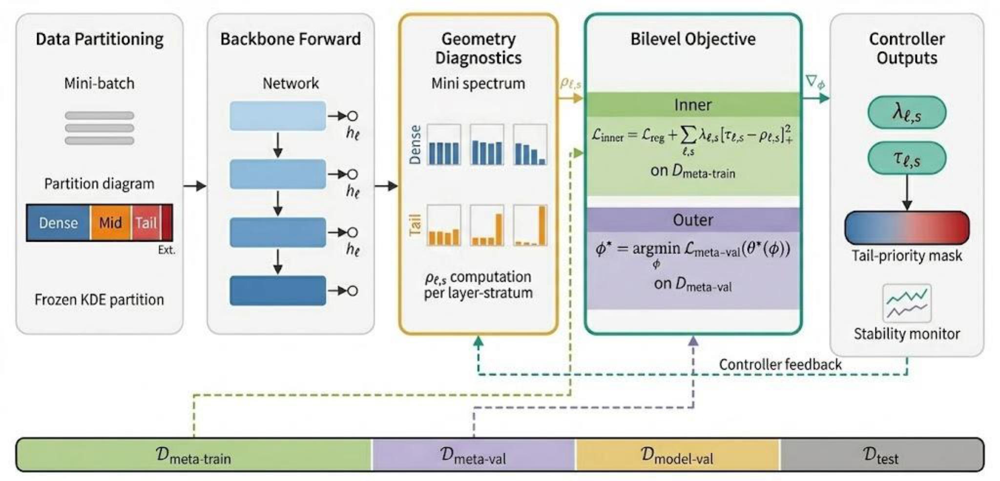
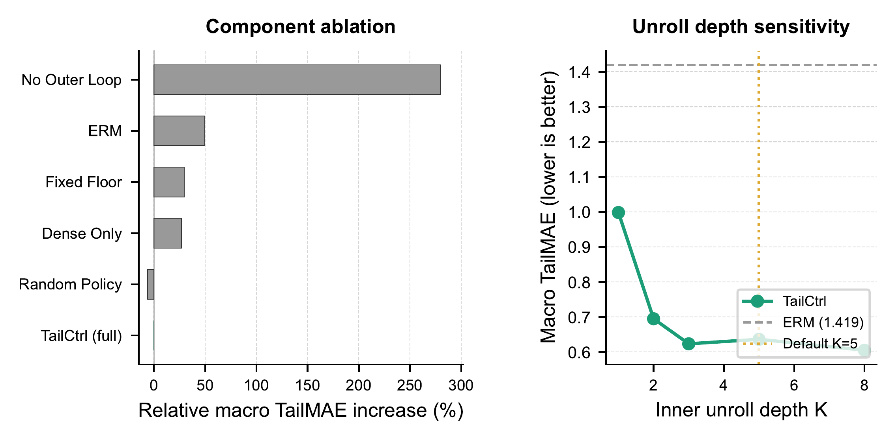

# TailCtrl

**When a rare target collapses the hidden representation, the control is a floor on that stratum's participation ratio.**

TailCtrl trains a tabular regressor under layer-wise spectral floors. A controller reads the participation ratio of each density stratum and emits a floor and a penalty. The predictor takes inner steps under those floors. A truncated bilevel step updates the controller from held-out tail error. A sparsity charge on the non-tail penalties sits in that outer loss.

<p align="center">
  <a href="#when-rare-targets-collapse"><strong>The miss</strong></a>
  &nbsp;·&nbsp;
  <a href="#bilevel-floors"><strong>The controller</strong></a>
  &nbsp;·&nbsp;
  <a href="#ablation"><strong>Ablation</strong></a>
  &nbsp;·&nbsp;
  <a href="#quick-start"><strong>Quick start</strong></a>
  &nbsp;·&nbsp;
  <a href="#layout"><strong>Layout</strong></a>
</p>

## When rare targets collapse

Squared error can stay low while the rare stratum folds onto a few directions. The dense stratum still spreads across many.

<p align="center">
  
</p>

## Bilevel floors

Each outer step builds stratum features once, holds the emitted floors for the inner steps, and differentiates held-out tail error through that unroll.

<p align="center">
  
</p>

## Ablation

Removing the outer update or freezing a single floor raises tail error relative to the full controller. The right panel is inner-unroll depth on three datasets.

<p align="center">
  
</p>

## Quick start

Python 3.10+ recommended.

```bash
python -m venv .venv
.venv\Scripts\activate
pip install -r requirements.txt
python scripts/smoke_tailctrl.py --config config/smoke.yaml --out-dir outputs/smoke
```

On macOS or Linux, activate with `source .venv/bin/activate`.

The hypergradient check is separate:

```bash
python scripts/smoke_hypergrad.py
```

## Reproduce

Default settings are in `config/tailctrl_default.yaml`. Outputs stay under `outputs/`.

```bash
python scripts/run_phase_a_suite.py --config config/tailctrl_default.yaml --seed 42
python scripts/run_benchmark_suite.py --config config/tailctrl_default.yaml --seed 42 --out-dir outputs/suite
python scripts/run_multi_seed_suite.py --config config/tailctrl_default.yaml --seeds 0 1 2 3 4
python scripts/aggregate_experiment_outputs.py --out-dir outputs/aggregated
```

## Layout

```
src/tailctrl/     data, backbone, geometry, controller, losses, bilevel trainer
scripts/          smoke tests and experiment drivers
config/           YAML settings
docs/figures/     figures used in this README
```

## Notes

- The participation ratio is \((\operatorname{tr}\Sigma)^2 / \|\Sigma\|_F^2\) on the stratum sample covariance. A zero covariance is set to 1.
- A stratum enters the geometry term when the minibatch holds at least two of its rows.
- The sparsity charge is added to the outer loss. The emitted floors are held fixed during the inner steps.
